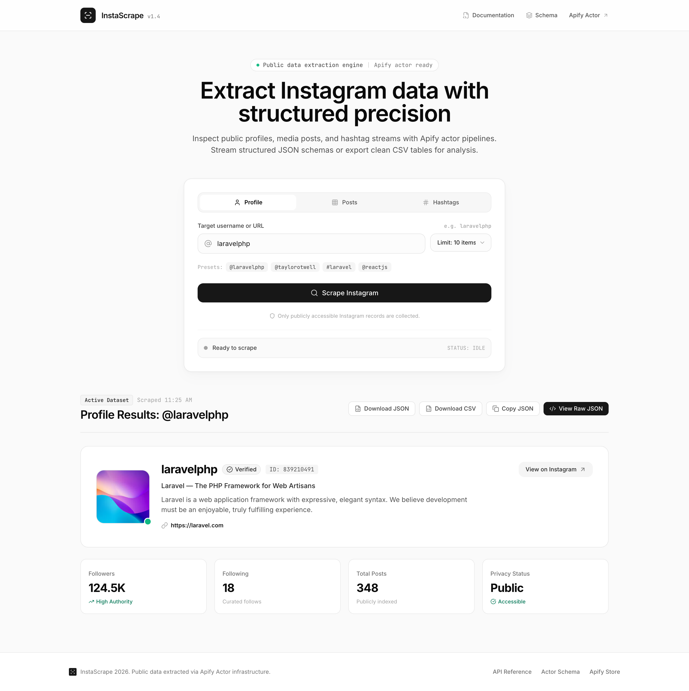

<p align="center">
  
</p>

# InstaScrape

InstaScrape is a Laravel application that wraps the [Apify Instagram Scraper](https://apify.com/apify/instagram-scraper) actor in a focused web UI. Enter a public Instagram username, post URL, or hashtag, and get normalized profile or media data back as structured JSON — ready to inspect, copy, or download as JSON or CSV.

Apify credentials stay on the server. The browser only talks to this application.

## Features

- **Three scrape modes** — profile details, a profile's posts, or posts for a hashtag.
- **Async execution** — start an Apify run, then poll its status until it finishes, fails, or times out.
- **Synchronous fallback** — `POST /scrape` without `async` waits for the run and returns the dataset in one response.
- **Normalized output** — raw actor items are mapped to stable profile and post shapes for the UI and API.
- **Content type detection** — posts are labelled `Photo`, `Video`, `Reel`, `Carousel`, or `IGTV`.
- **Export tools** — download the active dataset as JSON or CSV, copy it, or inspect the raw Apify payload.
- **Graceful failures** — validation errors, Apify failures, run timeouts, and empty datasets each produce a clear response.
- **Server-side secrets** — `APIFY_TOKEN` is read from configuration and never exposed to the frontend.

## Tech stack

| Layer | Tools |
| --- | --- |
| Backend | PHP 8.3+ (tested on 8.4), Laravel 13 |
| HTTP client | Laravel `Http` facade |
| Frontend | Blade, vanilla JavaScript, Tailwind CSS (CDN in the scraper view) |
| Build | Vite 8, Tailwind CSS 4 |
| Tests | Pest 5 |

The default database is SQLite. Sessions, cache, and queues use the database drivers, so migrations are required even though scraping data itself is not persisted.

## Requirements

- PHP 8.3 or newer
- Composer
- Node.js 20.19+ (required by Vite 8)
- An [Apify](https://apify.com/) account and API token

## Getting started

The quickest path is the bundled setup script:

```bash
composer run setup
```

That installs PHP and JS dependencies, creates `.env`, generates an app key, runs migrations, and builds the frontend.

Then add your Apify token to `.env`:

```dotenv
APIFY_TOKEN=your_apify_api_token
```

Start the application:

```bash
php artisan serve
```

Open the URL printed by Artisan (usually `http://127.0.0.1:8000`).

For a combined dev environment with Vite HMR:

```bash
composer run dev
```

### Manual setup

```bash
composer install
cp .env.example .env
php artisan key:generate
php artisan migrate
npm install
npm run build
```

## Configuration

Apify settings live in `config/services.php` and are read from `.env`.

| Variable | Required | Default | Purpose |
| --- | --- | --- | --- |
| `APIFY_TOKEN` | Yes | — | Apify API token used for all actor and dataset requests. |
| `APIFY_ACTOR_ID` | No | `apify/instagram-scraper` | Actor to run. Slashes are converted to `~` for the API URL. |
| `APIFY_TIMEOUT` | No | `120` | Maximum seconds to wait for a synchronous run. |
| `APIFY_USER_ID` | No | — | Accepted for compatibility; token authentication does not require it. |

## How a scrape works

1. The UI submits `mode`, `target`, `limit`, and `async: true` to `POST /scrape`.
2. The service maps the request to the actor's `directUrls`, `resultsType`, and `resultsLimit` inputs and starts a run.
3. The UI polls `GET /scrape/status/{runId}` every 2 seconds, for up to roughly 120 seconds.
4. When the run succeeds, the default dataset is fetched, normalized, and returned.
5. When the run is empty or fails, the UI shows the corresponding state.

Mode mapping:

| Mode | Target example | Actor input |
| --- | --- | --- |
| `profile` | `@laravelphp` or profile URL | `resultsType: details`, `resultsLimit: 1` |
| `posts` | `laravelphp` or profile URL | `resultsType: posts`, `resultsLimit: limit` |
| `hashtags` | `#laravel` or hashtag URL | `resultsType: posts`, `resultsLimit: limit` |

Usernames, hashtags, and URLs are cleaned before being sent, so `@name`, `name`, and `https://instagram.com/name/` all work.

## API reference

### `POST /scrape`

```json
{
  "mode": "profile",
  "target": "laravelphp",
  "limit": 10,
  "async": true
}
```

| Field | Rules |
| --- | --- |
| `mode` | Required; one of `profile`, `posts`, `hashtags`. |
| `target` | Required string, up to 255 characters. |
| `limit` | Optional integer from 1 to 50; defaults to 10. |
| `async` | Optional boolean; when true, returns a run ID immediately. |

Async response:

```json
{
  "status": "queued",
  "run_id": "abc123",
  "mode": "profile",
  "target": "laravelphp",
  "limit": 10
}
```

Synchronous response:

```json
{
  "status": "completed",
  "mode": "profile",
  "target": "laravelphp",
  "data": {},
  "raw": [],
  "count": 1
}
```

`status` is `completed` when data is returned and `empty` when the dataset has no public items.

### `GET /scrape/status/{runId}`

Requires `mode` and `target` query parameters, for example:

```
/scrape/status/abc123?mode=profile&target=laravelphp
```

Possible `status` values: `queued`, `running`, `completed`, `empty`, `failed`. Completed responses include the normalized `data`, the raw dataset items, and a `count`.

### Error responses

| Condition | HTTP status |
| --- | --- |
| Invalid input | `422` with field errors |
| Apify API or run failure | `422` |
| Synchronous run timeout | `504` |
| Unexpected exception | `500` |

All error bodies use `{ "status": "failed", "message": "..." }`.

## Response shapes

### Profile

```json
{
  "id": "839210491",
  "username": "laravelphp",
  "fullName": "Laravel Framework",
  "biography": "The PHP Framework for Web Artisans.",
  "profilePicUrl": "https://example.com/avatar.jpg",
  "externalUrl": "https://laravel.com",
  "followersCount": 125000,
  "followingCount": 20,
  "postsCount": 350,
  "isVerified": true,
  "category": "Software Company",
  "scrapedAt": "2026-11-20T10:00:00+00:00"
}
```

### Post or hashtag item

```json
{
  "id": "post_101",
  "shortcode": "CX123ABC",
  "caption": "Exciting news from the Laravel ecosystem!",
  "likesCount": 1500,
  "commentsCount": 85,
  "timestamp": "2026-03-01T12:00:00Z",
  "displayUrl": "https://example.com/post1.jpg",
  "url": "https://www.instagram.com/p/CX123ABC/",
  "type": "Image",
  "productType": "",
  "contentType": "Photo",
  "childCount": 0,
  "videoUrl": "",
  "videoViewCount": null,
  "videoPlayCount": null
}
```

## Testing

```bash
php artisan test --compact
# or
vendor/bin/pest
```

- `tests/Feature/ScraperTest.php` covers the index page, validation, all three scrape modes, empty datasets, run failures, and async start/poll flow using `Http::fake()`.
- `tests/Unit/InstagramScraperServiceTest.php` covers target cleaning, actor input mapping, result normalization, and content type detection.

## Project structure

```text
app/
├── Exceptions/
│   ├── ApifyException.php
│   └── ApifyTimeoutException.php
├── Http/Controllers/ScraperController.php
└── Services/InstagramScraperService.php
config/services.php              # Apify credentials and actor settings
resources/views/scraper/index.blade.php
routes/web.php
tests/Feature/ScraperTest.php
tests/Unit/InstagramScraperServiceTest.php
```

`index.html` in the repository root is the standalone design prototype; the served application uses `resources/views/scraper/index.blade.php`.

## Notes and limitations

- Only publicly accessible Instagram data can be scraped. Private or nonexistent targets return an `empty` result.
- Each run consumes Apify credits according to your Apify plan.
- The UI polls for about two minutes. Longer runs should be handled by increasing the client timeout or moving the flow to a queue.
- Scrape results are shown in the UI and returned by the API; they are not stored in the database.
